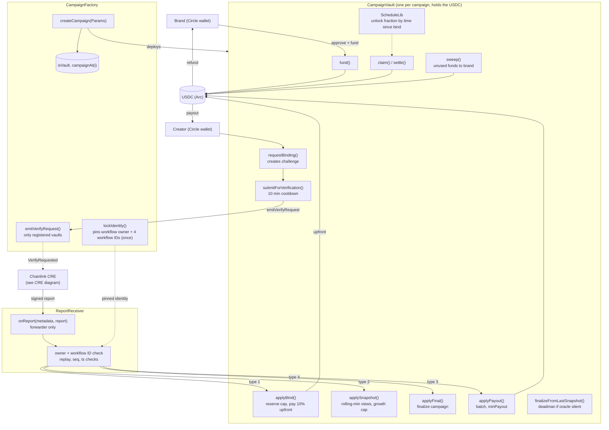

****# OutVest

> The project lives in the [`outvest/`](outvest) folder of this repository. Paths below are relative to that folder unless they are links.

**Please also access the app from Arc Studio:** https://arc-studio-76515ed277234807858c66b9.vercel.app/ (initial UI)
Final UI - https://arc-studio-76515ed277234807858c66-shanrahul04gmailcoms-projects.vercel.app/?_gl=1*1emmhc5*_gcl_au*NDgyOTIyNTgxLjE3OTMyMjEyMjMuMTE1NDYuMTc5NDAxNzQ1OC4xNzk0MDE3NDU3LjYyNjEyMjY4MS4xNzkzOTcxNTYyLjE3OTQwMTgxMDg.

Escrowed USDC payouts for YouTube creators, on **Arc**, verified by **Chainlink CRE**.

A brand locks USDC in a campaign vault. A creator proves they own a video, the vault pays them 10% of their cap straight away, and the rest is released as verified views accumulate and a fixed schedule unlocks. Nobody can edit the rules once the vault exists, and the view numbers do not come from either party.

- [How it fits together](#how-it-fits-together)
- [Part 1: Chainlink CRE (the verifier)](#part-1-chainlink-cre-the-verifier)
- [Part 2: Arc smart contracts (the money)](#part-2-arc-smart-contracts-the-money)
- [Cross-chain earnings receipts (CCIP)](#cross-chain-earnings-receipts-ccip)
- [Honest status](#honest-status)
- [Repository layout, addresses, running it](#repository-layout)

---

## How it fits together

```
  BRAND                         CREATOR (Circle wallet)
    │ createCampaign, fund()       │ requestBinding(videoId)   -> challenge stored on the vault
    │                              │ paste challenge in YouTube description
    ▼                              │ submitForVerification()
┌───────────────────────────────── ARC ─────────────────────────────────┐
│  CampaignVault ──emitVerifyRequest──► CampaignFactory                  │
│                                        emit VerifyRequested  ◄── (1) TRIGGER
└───────────────────────────────────────────┬────────────────────────────┘
                                            │ EVM log trigger
                         ┌──────────────────▼───────────────────┐
                         │      CHAINLINK CRE  (DON nodes)      │
                         │ read chain · call YouTube · agree    │
                         │ (median) · sign report (2) PROOF     │
                         └──────────────────┬───────────────────┘
                                            │ writeReport
┌───────────────────────────────── ARC ─────▼───────────────────────────┐
│ Chainlink Forwarder ─► ReportReceiver.onReport(metadata, report)  (3)  │
│    checks sender, workflow owner/ID, replay, timestamps                │
│    routes by type ─► CampaignVault.applyBind / applySnapshot /         │
│                      applyFinal / applyPayout ─► USDC to the creator   │
└────────────────────────────────────────────────────────────────────────┘
```

The contracts cannot read the internet. CRE reads YouTube, many independent nodes must agree, and the result arrives as one signed report. The contracts only act on reports that pass every check in step 3.

---

# Part 1: Chainlink CRE (the verifier)

Code: [`chainlink/outvest-cre/`](outvest/chainlink/outvest-cre) (TypeScript SDK 1.23.0). Four workflows share one report format.

## 1.1 Where the trigger lives

There are two trigger types.

**Event trigger (bind).** A creator clicking *Verify* calls `CampaignVault.submitForVerification()` ([CampaignVault.sol:195](outvest/outvest_smart_contract_builder_5aq5r7/contracts/CampaignVault.sol)), which calls `CampaignFactory.emitVerifyRequest(...)`. The factory then emits:

```solidity
event VerifyRequested(address indexed vault, address indexed wallet, bytes32 indexed videoId, bytes32 challenge);
```

([CampaignFactory.sol:75-78](outvest/outvest_smart_contract_builder_5aq5r7/contracts/CampaignFactory.sol)). Only registered vaults can call `emitVerifyRequest`, so the event cannot be forged.

The workflow subscribes to that exact event ([wf-bind/main.ts:51-56](outvest/chainlink/outvest-cre/wf-bind/main.ts)):

```ts
handler(
  client.logTrigger({
    addresses: [hexToBase64(config.factory)],
    topics: [{ values: [hexToBase64(VERIFY_TOPIC)] }],   // keccak256("VerifyRequested(address,address,bytes32,bytes32)")
  }),
  onVerifyRequested,
)
```

**Cron triggers (snapshot, final, payout).** These use `CronCapability`, with schedules set in each `config.staging.json`.

| Workflow | Trigger | Schedule (staging config) | Report type |
|---|---|---|---|
| `wf-bind` | EVM log: `VerifyRequested` on the factory | per click | 1 BIND |
| `wf-snapshot` | Cron | every 6 hours | 2 SNAPSHOT |
| `wf-final` | Cron | daily, acts only after `bindDeadline + scheduleLength` | 3 FINAL |
| `wf-payout` | Cron | every 12 hours | 4 CLAIM |

### CRE architecture diagram

```mermaid
flowchart LR
  subgraph ARC1["Arc (on-chain)"]
    V["CampaignVault<br/>submitForVerification()"]
    F["CampaignFactory<br/>emit VerifyRequested"]
    V -->|emitVerifyRequest| F
  end

  subgraph CRE["Chainlink CRE (DON nodes, WASM sandbox)"]
    direction TB
    T1["Trigger: EVM log<br/>VerifyRequested (wf-bind)"]
    T2["Trigger: Cron<br/>snapshot 6h, payout 12h, final daily"]
    R["EVM reads (max 15 per run)<br/>creators, videosOf, claimable,<br/>bindDeadline, finalized"]
    S[("CRE secrets<br/>YOUTUBE_API_KEY")]
    N1["Node 1<br/>YouTube API"]
    N2["Node 2<br/>YouTube API"]
    N3["Node N<br/>YouTube API"]
    C["Consensus<br/>median(views), identical(challenge found)"]
    E["Envelope<br/>abi.encode(type, vault, seq, ts, payload)"]
    G["DON signs report<br/>runtime.report()"]
    T1 --> R
    T2 --> R
    R --> N1 & N2 & N3
    S -.-> N1 & N2 & N3
    N1 & N2 & N3 --> C --> E --> G
  end

  subgraph ARC2["Arc (on-chain)"]
    FW["Chainlink Forwarder"]
    RR["ReportReceiver.onReport"]
    CK{"Checks<br/>sender is forwarder<br/>workflow owner + ID pinned<br/>no replay, seq up, ts fresh"}
    FW --> RR --> CK
  end

  F -->|log event| T1
  G -->|writeReport| FW
  CK -->|accepted| ROUTE["Route by type<br/>1 BIND, 2 SNAPSHOT, 3 FINAL, 4 CLAIM"]
  CK -->|soft fail| REJ["ReportRejected(reason)"]
```



## 1.2 What each workflow does

**`wf-bind` (register a video).**
1. Decode the event: vault, wallet, video id, challenge.
2. Each node calls the YouTube Data API for that video (`snippet,statistics`). The API key comes from CRE secrets, never from the contracts or the repo.
3. Check that the challenge hash appears in the description ([`descriptionHasChallenge`](outvest/chainlink/outvest-cre/common/report.ts)).
4. If it is missing, send nothing (`NO_CHALLENGE`). If found, send a BIND report with the **baseline view count**.

**`wf-snapshot` (track views).** Reads each vault's creators and bound videos (`creators`, `videosOf`), fetches current view counts in batches of up to 50, and sends one SNAPSHOT report per batch. A video YouTube does not return is left out, so the vault leaves it unchanged.

**`wf-final` (close).** Same code path as snapshot, but only acts once `bindDeadline + scheduleLength` has passed and the vault is not finalized. The final counts must fit in one report (at most 50 videos).

**`wf-payout` (keeper).** For each creator it reads `claimable(wallet)`, picks those at or above the vault's `minPayout`, and sends CLAIM reports in batches of up to 25. The report carries wallet addresses only, and the vault works out every amount itself.

Each workflow is limited to 15 EVM reads per execution, so the shared code ([`common/vaults.ts`](outvest/chainlink/outvest-cre/common/vaults.ts)) budgets reads and continues on the next run.

## 1.3 How the "proof" is produced

There are three layers of proof, each answering a different question.

**Proof of ownership: the on-chain challenge.**
`requestBinding` computes
`challenge = keccak256(abi.encode(vault, wallet, videoId, nonce, chainId))` and stores it as the creator's pending binding. Only the video's owner can edit its description, so finding that 64-hex string in the description proves control of the video. The nonce increases on every request, so a challenge can never be reissued.

**Proof the numbers are real: node consensus.**
Every node runs the YouTube fetch independently, inside `runInNodeMode` ([`common/youtube.ts`](outvest/chainlink/outvest-cre/common/youtube.ts)). The nodes' results are combined with `ConsensusAggregationByFields`:
- view counts use `median` (one fixed slot per video, 50 slots), so one wrong or malicious node cannot move the value;
- the "challenge found" flag uses `identical`, so every node must agree on it.

**Proof the report is authentic: the DON signature.**
The agreed result is encoded into one envelope and signed as a CRE report ([`common/chain.ts`](outvest/chainlink/outvest-cre/common/chain.ts)):

```ts
const report = runtime.report(prepareReportRequest(envelope)).result()   // DON signs
client.writeReport(runtime, { receiver, report, gasConfig })             // forwarder delivers it
```

The envelope is `abi.encode(uint8 type, address vault, uint64 seq, uint64 ts, bytes payload)`:

| Type | Name | Payload |
|---|---|---|
| 1 | BIND | wallet, videoId, challenge, baselineViews |
| 2 | SNAPSHOT | videoIds[], views[] (up to 50) |
| 3 | FINAL | videoIds[], views[] (up to 50) |
| 4 | CLAIM | wallets[] (up to 25) |

`seq` is derived from the DON time (`ms × 16 + chunk`), so it only goes up. `ts` is in seconds.

## 1.4 What the chain checks before acting

`ReportReceiver.onReport` ([ReportReceiver.sol:53](outvest/outvest_smart_contract_builder_5aq5r7/contracts/ReportReceiver.sol)) runs these checks in order:

1. `msg.sender == forwarder`, so only the Chainlink forwarder can call it.
2. The metadata's **workflow owner** matches the owner pinned in the factory.
3. The metadata's **workflow ID** matches the one pinned for that report type (a bind workflow cannot send payouts).
4. The report type is 1 to 4 and the vault is registered with the factory.
5. The report hash was not seen before (**replay protection**).
6. `seq` is greater than the last `seq` for that vault and type, and `ts` is not more than 15 minutes in the future, not older than 3 days, and not older than the last accepted `ts`.

A failed soft check emits `ReportRejected(vault, type, reason)`. Success emits `ReportAccepted(vault, type, seq)`. The pinning happens once, in `CampaignFactory.lockIdentity(owner, bindId, snapshotId, finalId, payoutId)`, which can only be called once and only by the deployer. After that, only your deployed workflows can move money.

## 1.5 Demo mode (what actually runs today)

Chainlink has not yet enabled CRE deploy access for this account (`cre account access`). The four workflows are written, typecheck, and run in `cre workflow simulate` (the bind path was verified against a real video), but the simulator uses a mock forwarder, so a report cannot land on-chain from it.

So the **demo factory** uses a **relayer** instead: [`relayer/cli.ts`](outvest/chainlink/outvest-cre/relayer/cli.ts). It reads the same `VerifyRequested` event, calls YouTube, builds the same envelopes, and calls `onReport` from the wallet set as that factory's forwarder.

```bash
cd chainlink/outvest-cre
FACTORY=0xEfFB32747853C507c3cfa9C2a8f16DbC0eA5dFc8 bun run watch
```

`watch` discovers every campaign from the factory, answers each verification request (retrying while the creator edits the description), posts snapshots, claims what is due, and finalizes. Each step is appended to `relayer/cre-log.jsonl`, which the creator page shows in its **CRE activity** box.

**Trust difference:** in demo mode one key is the oracle. With deployed CRE workflows and a locked identity, many nodes in consensus are the oracle. Do not describe the demo as decentralized.

---

# Part 2: Arc smart contracts (the money)

Code: [`outvest_smart_contract_builder_5aq5r7/contracts/`](outvest/outvest_smart_contract_builder_5aq5r7/contracts). USDC on Arc has 6 decimals. 244 Foundry tests pass (`FOUNDRY_SOLC_VERSION=0.8.27 forge test`).

There are four core contracts: `CampaignFactory`, `ReportReceiver`, `CampaignVault` (one per campaign) and `ScheduleLib`.

### Arc architecture diagram



Money state inside a vault: `totalFunded` (deposited) = `totalPaid` (sent out) + `liability` (still reserved for bound creators) + free balance (swept back to the brand). A new creator is only accepted if `liability + cap` fits in the vault's balance.

## 2.1 `CampaignFactory`

| Function / event | What it does |
|---|---|
| `lockIdentity(owner, bindId, snapshotId, finalId, payoutId)` | One-time, deployer-only. Pins the workflow owner and the four distinct workflow IDs. Irreversible. |
| `createCampaign(Params)` | Validates parameters and deploys a new `CampaignVault`. Requires the identity to be locked. Stores a `rulesHash` of the parameters and the pinned identity. |
| `emitVerifyRequest(wallet, videoId, challenge)` | Only registered vaults may call it. Emits `VerifyRequested`, the CRE trigger. |
| `campaignCount()`, `campaignAt(i)` | Enumerate every campaign. |
| `isVault(addr)` | Whether an address is a vault this factory deployed. |
| `receiver`, `forwarder`, `workflowOwner`, `wfBind` / `wfSnapshot` / `wfFinal` / `wfPayout` | The trust anchors. |
| Events | `IdentityLocked`, `CampaignCreated(vault, brand, rulesHash)`, `VerifyRequested` |

Parameter validation covers: non-zero brand and token, a future bind deadline, non-zero cap and rate, 1 to 10 videos per creator, a bucket length of 1 hour to 7 days, `staleAfter` of at least 1 day, and `upfrontPpm` of at most 100,000 (10%). The unlock schedule is checked by `ScheduleLib.validate`.

## 2.2 `ReportReceiver`

The only entry point CRE uses. `onReport(metadata, report)` runs the checks in section 1.4, then routes by type:

| Type | Calls on the vault |
|---|---|
| 1 BIND | `applyBind(wallet, videoId, challenge, baselineViews)` |
| 2 SNAPSHOT | `applySnapshot(ids, views, ts)` |
| 3 FINAL | `applyFinal(ids, views, ts)` |
| 4 CLAIM | `applyPayout(wallets)` |

It also validates each payload shape (`MALFORMED_PAYLOAD`, `LENGTH_MISMATCH`, `BATCH_TOO_LARGE`). Rejection reasons are stable ASCII codes: `DEADLINE`, `NO_MATCH`, `VIDEO_TAKEN`, `FULL`, `BUDGET`, `MAX_VIDEOS`, `STALE_SEQ`, `STALE_TS`, `FUTURE_TS`, `UNKNOWN_VIDEO`, `FINALIZED`, `FINAL_TOO_EARLY`.

## 2.3 `CampaignVault` (escrow, earnings, payouts)

Each campaign is its own contract holding that campaign's USDC.

**Parameters** (fixed at creation): brand, USDC token, `bindDeadline`, `ratePerThousand` (USDC per 1,000 views), `capPerCreator`, `maxCreators`, `maxVideosPerCreator`, `bucketLen`, `maxGrowthPerDay`, `staleAfter`, `deadmanTimeout`, `minPayout`, `upfrontPpm`, and the unlock `schedule` (up to 8 segments).

**Functions callable by people**

| Function | Who | What it does |
|---|---|---|
| `fund(amount)` | Anyone (the brand) | Pulls USDC in. Rejects fee-on-transfer tokens by checking the balance change. Reverts after finalization. |
| `requestBinding(videoId)` | Creator | Validates the video id, checks the campaign is open, the video is unowned and the creator is under the video limit. Stores the challenge and increments the nonce. |
| `submitForVerification()` | Creator | Needs a pending binding. 10-minute cooldown. Emits the CRE trigger through the factory. |
| `claim(wallet)` | Anyone | Pays out the wallet's claimable amount to that wallet. |
| `settle(wallet)` | Anyone | After finalization, fixes the creator's final entitlement and pays it. The final amount is never below the upfront share. |
| `finalizeFromLastSnapshot()` | Anyone | If the oracle goes silent, finalizes after `bindDeadline + scheduleLength + deadmanTimeout` using the last snapshot. |
| `sweep()` | Anyone | After the bind deadline, sends any balance above `liability` back to the brand. |

**Functions callable only by the receiver (from CRE reports)**

| Function | What it does |
|---|---|
| `applyBind` | Matches the challenge and video, then binds the creator. Rejects on deadline, mismatch, taken video, video limit, full campaign, or a vault that cannot cover another cap (`BUDGET`). Records the baseline views. Reserves `capPerCreator` as liability and **pays the upfront share in the same transaction** on the creator's first video. |
| `applySnapshot` | Applies up to 50 view observations. Skips unknown videos and stale timestamps (`EntrySkipped`). |
| `applyFinal` | Same, but only after `bindDeadline + scheduleLength`; then finalizes the campaign. |
| `applyPayout` | Pays up to 25 wallets, only those at or above `minPayout`. |

**Views (read-only):** `claimable`, `creators(offset, limit)`, `creatorInfo`, `videosOf`, `videoInfo`, `schedule`, `pendingBinding`, plus `totalFunded`, `totalPaid`, `liability`, `creatorCount`, `finalized`.

## 2.4 How earnings and payouts are calculated

1. **Upfront.** On a creator's first verified video, `upfront = capPerCreator × upfrontPpm / 1,000,000` (10% at the maximum). It pays immediately and ignores `minPayout`. If the transfer fails, state is restored and the amount stays claimable.
2. **Credited views.** For each video the vault tracks `views − baseline`, using the **minimum observed value across a rolling window of 7 time buckets**. Spikes that do not persist are ignored. Growth is also limited to `maxGrowthPerDay` between observations, so a bot burst cannot jump the credit.
3. **Earned.** `earned = min(creditedViews × ratePerThousand / 1000, capPerCreator)`.
4. **Unlocked.** `viewBased = earned × schedule fraction`, where the fraction depends on time since the creator was bound (`ScheduleLib.fractionPpm`). Example demo schedule: 25% at day 0, 50% at day 30, 80% at day 60, 100% at day 90.
5. **Claimable.** `max(upfront, viewBased) − paid`, capped at what the creator still has reserved. View-based pay only counts while snapshots are fresh (`lastSnapshotTs + staleAfter`), so the vault cannot pay out on stale data.
6. **Settlement.** After finalization the fraction is 100%. `settle` pays the final amount, and `sweep` returns unused funds to the brand.

**Solvency:** `liability` is the total still owed. `applyBind` refuses a new creator if `liability + cap` would exceed the vault's balance, so every bound creator's cap is always covered.

## 2.5 `ScheduleLib`

A monotone, piecewise-linear release curve, with all divisions rounding down.

- `validate` requires 1 to 8 segments, the first starting at 0, strictly increasing start times, a non-decreasing fraction that never goes above 100%, a final segment pinned at 100%, and a total length of at most 365 days. Any smooth ramp is capped at 25% per segment, so large amounts can only unlock through explicit steps.
- `fractionPpm(segments, elapsed)` returns the unlocked fraction in parts per million for the time since a creator was bound, interpolating inside the current segment.
- `defaultSchedule()` is the classic curve that starts at 0 and steps up to 100% at the end. The demo campaigns use a different one: 25% at day 0, 50% at day 30, 80% at day 60, 100% at day 90.

---

# Cross-chain earnings receipts (CCIP)

A creator can send a **receipt** of their payout total from Arc to Base Sepolia over Chainlink CCIP. It is proof of earnings, not a token bridge. `EarningsReceiptSender` (Arc) reads the vault's paid total and sends the message, and `EarningsReceiptReceiver` (Base Sepolia) stores it (`receipts(wallet, vault)`, `totalEarned(wallet)`). See [`docs/ccip-receipts.md`](outvest/outvest_smart_contract_builder_5aq5r7/docs/ccip-receipts.md).

---

# Honest status

- **Testnet only, unaudited.** Do not use real funds.
- **Oracle:** demo mode uses one relayer key. Real CRE deployment is waiting on Chainlink deploy access, and the production factory (`0xBD8e…17a4`) stays unlocked until then.
- **What is verified is public view count,** not view quality. If YouTube shows bought views, the vault will pay for them within the growth and cap limits. A second data source and spread check are planned.
- **Contracts only know what the oracle reports,** not whether a video follows a brief.

---

# Repository layout

| Path | What it is |
|---|---|
| `web/` | Next.js app: landing, Circle wallet onboarding, brand and creator dashboards, CRE activity log |
| `outvest_smart_contract_builder_5aq5r7/` | Final Solidity contracts, CCIP contracts, Foundry tests, deploy scripts, docs |
| `chainlink/outvest-cre/` | The four CRE workflows, shared code, and the relayer |
| `pitch/` | Brief for the pitch deck |
| `DEPLOYED_ADDRESSES.md` | Every deployed address on Arc Testnet and Base Sepolia |
| `outvest-architecture.md` | Full architecture and design decisions |

**Key addresses (Arc Testnet).** Full list in [DEPLOYED_ADDRESSES.md](outvest/DEPLOYED_ADDRESSES.md).

| Contract | Address |
|---|---|
| Demo `CampaignFactory` | `0xEfFB32747853C507c3cfa9C2a8f16DbC0eA5dFc8` |
| Demo `ReportReceiver` | `0xe32e77c2B3D177603594b7697706656E92fDE8cD` |
| `EarningsReceiptSender` | `0x96dfc97779d32f09988D6490159B4EcF4b31aBeE` |
| `EarningsReceiptReceiver` (Base Sepolia) | `0x38E64d11eD3982D108266fA7829E31dd70292061` |
| Production `CampaignFactory` (not locked) | `0xBD8e1748BE54775d32Cbd2Cbe193F2FD6Cd017a4` |

## Run it

```bash
# contracts
cd outvest_smart_contract_builder_5aq5r7 && bun install
FOUNDRY_SOLC_VERSION=0.8.27 forge test --match-path 'contracts/test/OutVest.*t.sol'

# CRE workflows
cd chainlink/outvest-cre && bun install && bun test common && bunx tsc --noEmit
cre workflow simulate wf-snapshot --target local-simulation --non-interactive --trigger-index 0

# relayer (demo mode; needs PRIVATE_KEY and YOUTUBE_API_KEY_VAR in .env)
FACTORY=0xEfFB32747853C507c3cfa9C2a8f16DbC0eA5dFc8 bun run watch

# web app (needs .env.local, see web/.env.example)
cd web && bun install && bun run dev
```

Secrets stay out of git: `.env`, `.env.local` and `broadcast/` are ignored. Use a dedicated RPC (`RPC_URL` for the relayer, `NEXT_PUBLIC_ARC_RPC` for the web app): the free public Arc RPC rate-limits.
